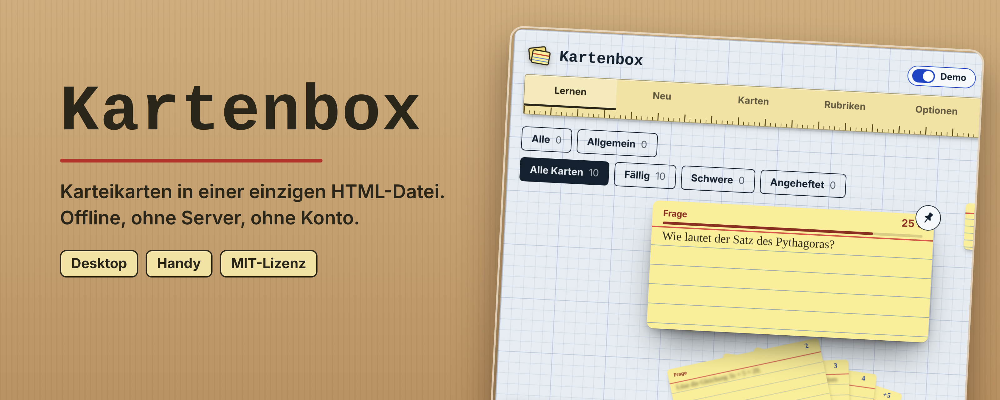

<p align="center"></p>

# Kartenbox

Karteikarten-App als **eine einzige HTML-Datei**. Läuft komplett offline, ohne Server, ohne Installation, ohne Konto. Datei öffnen, lernen.

Gelbe Karten im Fächer auf einem Schreibtisch, mit Fächern, Lernstand und Demo. Funktioniert am Desktop und auf dem Handy.

## Loslegen

1. [Neueste Version laden](https://github.com/Exulizer/Karteikarten/releases/latest) und `kartenbox-….zip` entpacken.
2. `karteikarten.html` im Browser öffnen (Doppelklick). Mehr braucht es nicht.

Der Schalter **Demo** zeigt die App mit Beispielkarten.

## Funktionen

- Karten in Rubriken, Fächer-Ansicht mit Nummern
- **Gewusst** und **Nochmal**: Nochmal-Karten wandern in die Ablage
- Karten **anheften** (Pin) und mit Markern kennzeichnen (Nochmal rosa, Später blau)
- Modi: alle, fällig, schwer, angeheftet
- Karten **speichern, laden und teilen** (Datei per E-Mail, Discord …)
- Hilfe mit FAQ direkt in der App
- Hell und Dunkel, schmale Ansicht für Handys

## Daten

Alles bleibt auf deinem Gerät, im Browser-Speicher oder, wenn du es wählst, in deinem Ordner. Dort entstehen:

| Datei | Inhalt |
|---|---|
| `karteikarten.json` / `karteikarten.js` | deine Karten |
| `einstellungen.js` | deine Einstellungen |

Diese Dateien gehören in denselben Ordner wie `karteikarten.html`. Updates überschreiben sie nie.

## Installieren (optional)

Als App im Browser installieren geht nur, wenn die Seite über `http(s)` geöffnet wird, nicht als lokale Datei. Die Datei selbst läuft immer, auch ohne Installation.

## Updates

Ist die Update-Suche an, fragt die App einmal am Tag bei GitHub nach einer neuen Version.

- **Desktop** (Chrome, Edge mit Ordnerzugriff): auf „Aktualisieren“ klicken. Geprüfte Dateien ersetzen die alten, Sicherung als `.alt`.
- **Handy und Co.**: nur ein Hinweis mit Link zur Release-Seite.

Abschalten: Optionen → Version. Ohne Update-Suche nimmt die App keine Verbindung auf.

## Datenschutz

Kein Tracking, keine Cookies, keine nachgeladenen Skripte oder Schriften. Einzige Verbindung: die Update-Suche (GitHub sieht dabei IP-Adresse und Uhrzeit). Mehr in der App unter Hilfe → Datenschutz.

## Für Entwickler

Quellen liegen in `quelle/`: `vorlage.html`, `kartenbox.css`, `kartenbox.js`, `version.json`.

```
python3 quelle/bauen.py
```

baut `karteikarten.html` und `version.json` (mit Prüfsummen). Danach alles ins Repo laden.

Das Repo für die Update-Suche steht in `quelle/kartenbox.js`:

```js
var UPDATE_REPO = 'Exulizer/Karteikarten', UPDATE_ZWEIG = 'main', UPDATE_ORDNER = '';
```

Neue Version veröffentlichen: Nummer und Text in `quelle/version.json` ändern, `bauen.py` ausführen, Dateien committen, Release mit passendem Tag anlegen. Siehe [CHANGELOG.md](CHANGELOG.md).

## Lizenz

[MIT](LICENSE)
