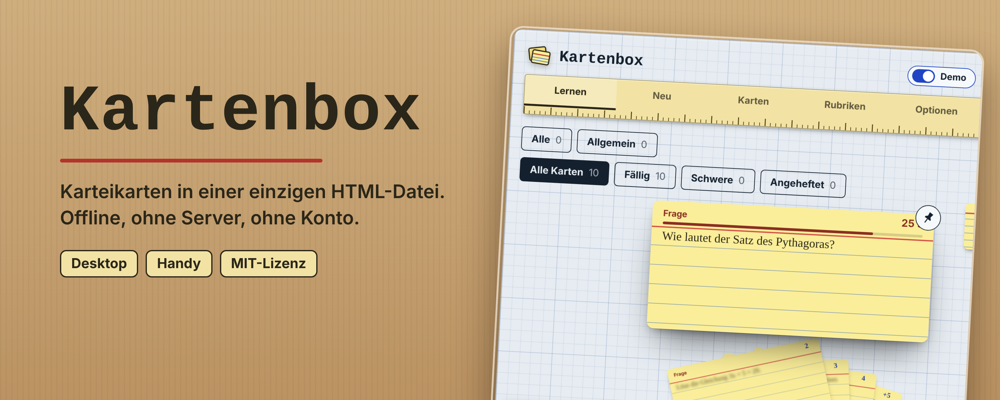

<p align="center"></p>

# KarteiDeck

Karteikarten-App als **eine einzige HTML-Datei**. Läuft komplett offline, ohne Server, ohne Installation, ohne Konto. Datei öffnen, lernen.

Gelbe Karten im Fächer auf einem Schreibtisch, mit Fächern, Lernstand und Demo. Funktioniert am Desktop und auf dem Handy.

## Loslegen

1. [Neueste Version laden](https://github.com/Exulizer/Karteikarten/releases/latest) und `kartenbox-….zip` entpacken.
2. `karteikarten.html` im Browser öffnen (Doppelklick). Mehr braucht es nicht.

Der Schalter **Demo** zeigt die App mit Beispielkarten.

## Funktionen

- Karten in Rubriken, Fächer-Ansicht mit Nummern
- **Gewusst** und **Nochmal**: Nochmal-Karten wandern in die Ablage
- Karten **anheften** (Pin) und mit Markern kennzeichnen (Nochmal rosa, Später blau)
- Modi: alle, fällig, schwer, angeheftet
- Lernarten: **Lückentext**, **Antwort tippen**, **rückwärts**, **Prüfung mit Note**, **Vorlesen**
- **Bilder**, **Tags** und Suche
- Import aus **CSV, Anki und Quizlet**, Export als CSV, **Drucken**
- **Fortschritt** (Tag, Monat, Jahr) mit Kalender, Stempeln und Tagesziel-Siegel
- **Deutsch und Englisch**, umschaltbar oben neben „Demo“
- Karten **speichern, laden und teilen** (Datei per E-Mail, Discord …)
- Hilfe mit FAQ direkt in der App
- Hell und Dunkel, Handy-Ansicht mit fünf Tabs

## Daten

Alles bleibt auf deinem Gerät, im Browser-Speicher oder, wenn du es wählst, in deinem Ordner. Dort entstehen:

| Datei | Inhalt |
|---|---|
| `karteikarten.json` / `karteikarten.js` | deine Karten |
| `einstellungen.js` | deine Einstellungen |

Diese Dateien gehören in denselben Ordner wie `karteikarten.html`. Updates überschreiben sie nie.

## Installieren (optional)

Als App im Browser installieren geht nur, wenn die Seite über `http(s)` geöffnet wird, nicht als lokale Datei. Die Datei selbst läuft immer, auch ohne Installation.

## Konto und Abgleich (optional, braucht PHP)

Ohne Server läuft alles wie bisher lokal. Mit PHP 8.1 oder neuer (und `api/` neben der HTML) kann man sich registrieren. Dann liegen Karten, Lernstand und Optionen zusätzlich im Konto und gleichen sich zwischen Geräten ab.

- Einschalten: in `einstellungen.js` bei `konto.api` den Pfad `api/index.php` eintragen (Standard). Leer lassen schaltet die Funktion ab. Es funktioniert nur über http(s), nicht aus einer lokalen Datei.
- Lokal testen: `php -S 127.0.0.1:8000` im App-Ordner, dann `http://127.0.0.1:8000/karteikarten.html` öffnen. Mails stehen dann in `api/data/mail.log`.
- Ohne Datenbank: Standard ist der Datei-Speicher (`api/data/store.json`) nur für Tests. Für den Betrieb `api/schema.sql` einspielen und in `api/config.local.php` (Vorlage: `config.local.php.example`) `store` auf `pdo` stellen.
- Schutz: Passwörter mit Argon2id, Sitzungs-Cookie mit `HttpOnly`, `SameSite` und `Secure` (bei https), CSRF-Token, Herkunftsprüfung, Rate-Limit für Anmeldung, Registrierung, Passwort-Reset und Kontakt (gespeichert wird nur ein Hash der IP), E-Mail-Bestätigung, Honigtopf im Kontaktformular, Mail-Header-Schutz.
- Vor dem Start: `anbieter` in `einstellungen.js` ausfüllen (Impressum, Datenschutz), `site_url`, `mail_from` und `contact_to` setzen, `.htaccess` mit Header prüfen (securityheaders.com), HTTPS erzwingen.

## Updates

Ist die Update-Suche an, fragt die App einmal am Tag bei GitHub nach einer neuen Version.

- **Desktop** (Chrome, Edge mit Ordnerzugriff): auf „Aktualisieren“ klicken. Geprüfte Dateien ersetzen die alten, Sicherung als `.alt`.
- **Handy und Co.**: nur ein Hinweis mit Link zur Release-Seite.

Abschalten: Optionen → Version. Ohne Update-Suche nimmt die App keine Verbindung auf.

## Datenschutz

Kein Tracking, keine Cookies, keine nachgeladenen Skripte oder Schriften. Einzige Verbindung: die Update-Suche (GitHub sieht dabei IP-Adresse und Uhrzeit). Mehr in der App unter Hilfe → Datenschutz.

## Für Entwickler

Quellen liegen in `quelle/`: `vorlage.html`, `kartenbox.css`, `kartenbox.js`, `version.json`.

```
python3 quelle/bauen.py
```

baut `karteikarten.html` und `version.json` (mit Prüfsummen). Danach alles ins Repo laden.

Neue Version veröffentlichen: Nummer und Text in `quelle/version.json` ändern, `bauen.py` ausführen, Dateien committen, Release mit passendem Tag anlegen. Siehe [CHANGELOG.md](CHANGELOG.md).

## Lizenz

[MIT](LICENSE)

Die Symbole in der Navigation sind von [Font Awesome Free](https://fontawesome.com/license/free) (CC BY 4.0), siehe [THIRD_PARTY.md](THIRD_PARTY.md).
